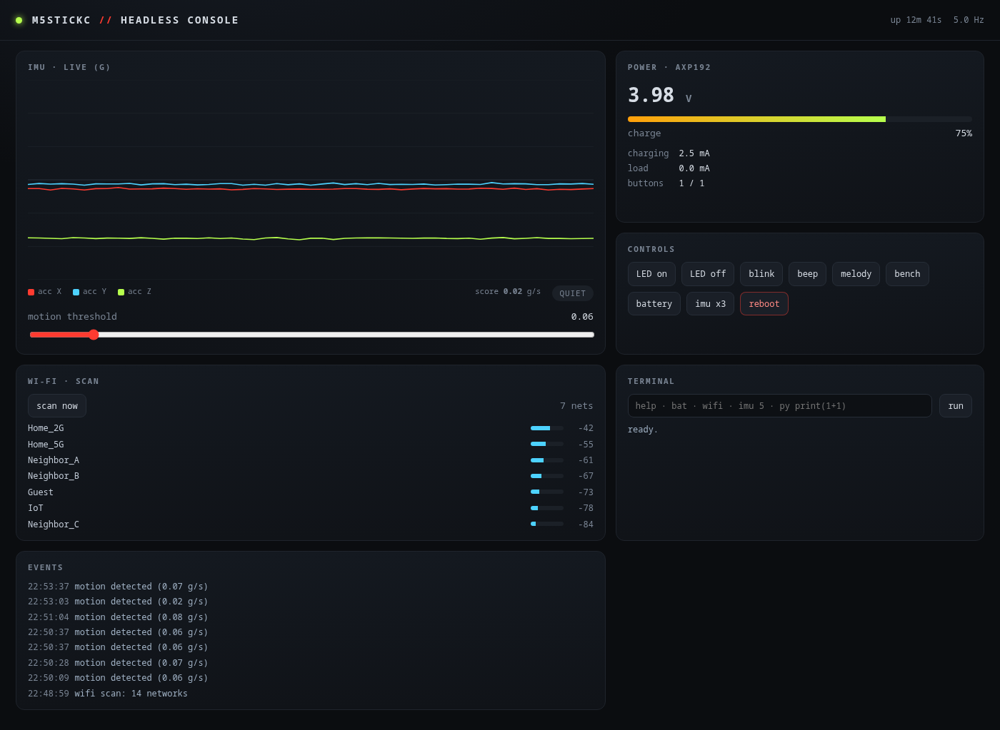

# M5StickC без экрана → headless-консоль

У меня в руках оказался маленький красный ESP32-стик **без работающего экрана**. Прошивка Bruce на нём была бесполезна: всё управление рассчитано на LCD. Этот репозиторий — история о том, как устройство превратилось в полноценный стенд:

- **MicroPython-прошивка** с собственной командной оболочкой по serial;
- **веб-панель** с живым графиком IMU, батареей, Wi-Fi и терминалом;
- **MCP-сервер** для opencode — управление платой прямо из чата с агентом.



## Что умеет

| Возможность | Как |
|---|---|
| Живой график акселерометра/гироскопа | панель, ~5 Гц, canvas без внешних библиотек |
| Батарея: напряжение, %, ток заряда/нагрузки | AXP192 по I2C |
| Кнопки A/B в реальном времени | GPIO 37/39 |
| Скан Wi-Fi с RSSI | `network.WLAN.scan()` |
| Детектор движения | jerk по акселерометру + порог |
| LED, бипер, мелодия | GPIO 10 / PWM 2 |
| Терминал в браузере | POST `/api/cmd` |
| Управление из opencode | MCP-инструменты `esp32.*` |
| Восстановление заводской прошивки | полный дамп flash |

## Быстрый старт

```bash
git clone https://github.com/<you>/m5stickc-headless-console.git
cd m5stickc-headless-console

# 1. прошить MicroPython (стирает flash!)
./scripts/flash-micropython.sh /path/to/ESP32_GENERIC-*.bin

# 2. залить оболочку и драйверы
./scripts/deploy-device.sh

# 3. запустить панель
uv run --with pyserial python dashboard/server.py
# → http://127.0.0.1:8770

# 4. (опционально) автозапуск
./scripts/install-service.sh
```

Требования: Linux, `uv`, `python3`, USB-кабель. Всё остальное (`esptool`, `mpremote`, `pyserial`) ставится через `uvx`/`uv run` без загрязнения системы.

## Архитектура

```
┌──────────────┐   HTTP    ┌─────────────────────────┐
│ браузер      │──────────▶│  dashboard (systemd)    │
└──────────────┘           │  единственный владелец  │
┌──────────────┐   HTTP    │  /dev/ttyUSB0           │
│ opencode MCP │──────────▶│  worker-поток + очередь │
└──────────────┘           └───────────┬─────────────┘
                                       │ UART 115200
┌──────────────┐  pause/resume         ▼
│ mpremote /   │────────────────▶ ┌─────────────┐
│ esptool      │                  │  M5StickC   │
└──────────────┘                  │  MicroPython│
                                  └─────────────┘
```

Ключевая идея: **UART один**, поэтому у него должен быть один владелец. Панель держит порт открытым и обслуживает очередь команд. MCP и браузер ходят через её HTTP API. Инструменты прошивки (`mpremote`, `esptool`) на время работы просят паузу — панель закрывает порт, а после завершения открывает снова.

## Структура репозитория

```
firmware/        main.py, stick.py — прошивка на плате
dashboard/       server.py + index.html — веб-панель
mcp/             MCP-сервер и общий слой доступа к порту
scripts/         прошивка, деплой, восстановление, сервис
docs/            подробная документация
```

## Документация

| Документ | О чём |
|---|---|
| [01-hardware](docs/01-hardware.md) | как опознано железо, I2C-карта, пины |
| [02-flashing](docs/02-flashing.md) | бэкап, прошивка MicroPython, возврат Bruce |
| [03-shell](docs/03-shell.md) | команды оболочки и их реализация |
| [04-dashboard](docs/04-dashboard.md) | API панели, worker, SSE, сервис |
| [05-mcp](docs/05-mcp.md) | подключение к opencode, инструменты |
| [06-pitfalls](docs/06-pitfalls.md) | 7 реальных багов и их причины |
| [07-roadmap](docs/07-roadmap.md) | presence, RSSI, CSI, автоматизации |

## Главные грабли (кратко)

1. Длинные строки в REPL **теряют байты** → короткая команда `sample` на плате.
2. `mpremote` не входит в raw REPL, если `main.py` сразу читает stdin → окно 1.2 с на Ctrl-C.
3. Гонка «панель закрыла порт / worker переоткрыл» → флаг `paused_until`.
4. MPU6886 отдаёт **big-endian** — иначе ±8 g мусора.
5. FTDI выше 115200 рвёт чтение flash.
6. AXP192 требует включить ADC (`0x82 = 0xFF`).
7. HTTP-ответ с `dict` вместо `json.dumps` → битый Content-Length.

Подробности и код — в [docs/06-pitfalls.md](docs/06-pitfalls.md).

## Ограничения

- Настоящий Wi-Fi-радар (CSI) в MicroPython недоступен — нужна C-прошивка (ESP-IDF/Arduino).
- RSSI-скан занимает 2–4 с: для presence по эфиру это медленно, но работает.
- Детектор движения сейчас по IMU (вибрация/касание), а не по отражению радиоволн.
- Порт один: панель и `mpremote repl` одновременно не живут.

## Лицензия

MIT. Делайте что хотите, только не публикуйте чужие MAC-адреса и SSID.
